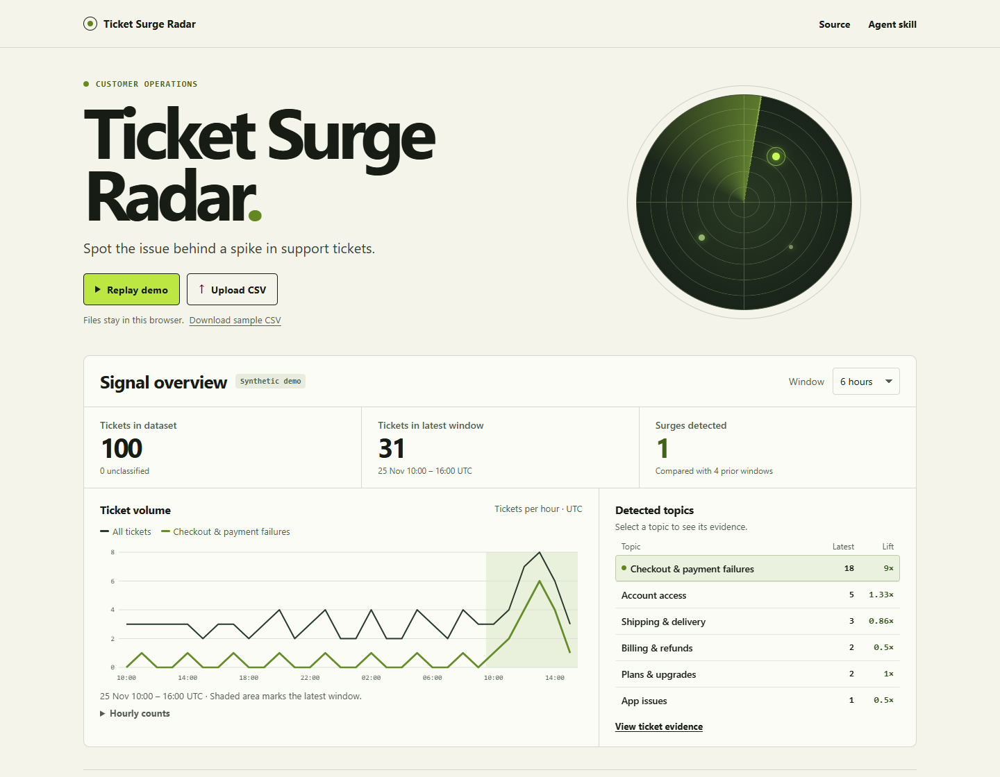

# Ticket Surge Radar

Ticket Surge Radar finds support topics that are rising faster than usual. Open the source tickets, compare the counts, and copy an incident draft for your team.

**[Open the live demo](https://assafsela-ai.github.io/ticket-surge-radar/)** · [Download the sample CSV](docs/sample-tickets.csv) · [Download the agent skill](docs/ticket-surge-radar-skill.zip)

[](https://assafsela-ai.github.io/ticket-surge-radar/)

## Try the checkout incident

1. Click **Run demo**. The synthetic dataset starts with 82 tickets. The replay adds 18 checkout reports with different wording.
2. Select **Checkout & payment failures**. The latest six-hour window contains 18 related tickets, compared with an average of 2 per prior window.
3. Open the source tickets and copy the draft incident brief.

## Analyze your own CSV

Click **Upload CSV**. The browser reads and analyzes the file locally. The app has no server, account, analytics, API key, or third-party runtime dependency.

| Column | Supported examples |
|---|---|
| Timestamp (required) | `created_at`, `created`, `timestamp`, `opened_at` |
| Ticket text (one or both required) | `subject`, `title`, `body`, `description`, `message` |
| Ticket ID (optional) | `ticket_id`, `id`, `ticket_number` |

Use a UTF-8 export, up to 10 MB and 10,000 rows. Commas, semicolons, tabs, and quoted multiline cells are supported. Use ISO timestamps such as `2026-11-25T13:00:00Z`. Dates without a timezone are read as UTC. Invalid rows and repeated ticket IDs are skipped and counted. If there is no ID, Radar uses the CSV record number.

## How detection works

- An English-language multinomial Naive Bayes classifier learns six support topics from small, synthetic labeled examples. It groups incoming tickets using matching words and their relative frequency. Ambiguous requests appear as **Unclassified**.
- The newest ticket sets the end of the current window, rounded up to the next hour UTC. Radar compares its count with the mean of up to four equal windows immediately before it. It assumes the export covers the intervening hours and treats hours without rows as zero.
- A topic needs at least two prior windows, at least four current tickets, and at least three tickets above baseline. It must reach at least twice the baseline. If the baseline is zero, it can appear as a new signal.
- A surge produces a draft from counts and source IDs. An operator verifies the cause and impact separately.

The starter model is suitable for English support exports that resemble the six topics. Customize the labeled examples in [radar.mjs](docs/radar.mjs) for your domain. Evaluate them against your own labeled tickets before relying on the output for decisions.

## Codex and Claude Code

The cloned repo includes project skills for both tools. Open a session in the repo and invoke `$ticket-surge-radar` in Codex or `/ticket-surge-radar` in Claude Code. For use in a different project, extract the entire [skill ZIP](docs/ticket-surge-radar-skill.zip) and copy its `ticket-surge-radar` folder.

| Agent | Project install | Personal install |
|---|---|---|
| [Codex](https://developers.openai.com/codex/skills) | `.agents/skills/` | `~/.agents/skills/` |
| [Claude Code](https://code.claude.com/docs/en/skills) | `.claude/skills/` | `~/.claude/skills/` |

The CLI and browser use the same analysis code. The CLI requires Node.js 22 or newer.

```sh
node tools/analyze.mjs --demo
node tools/analyze.mjs --window 12 -- "my-support-tickets.csv"
node --test tools/radar.test.mjs
```

To run the website locally, serve the `docs` folder with a static server. For example, run `python -m http.server 8000 --directory docs` and open `http://localhost:8000/`. GitHub Pages uses the `main` branch and `/docs` folder. After updating the analysis engine or skill, run `python tools/package-skill.py` to refresh the download and Claude Code copy.

## License

[MIT](LICENSE)
